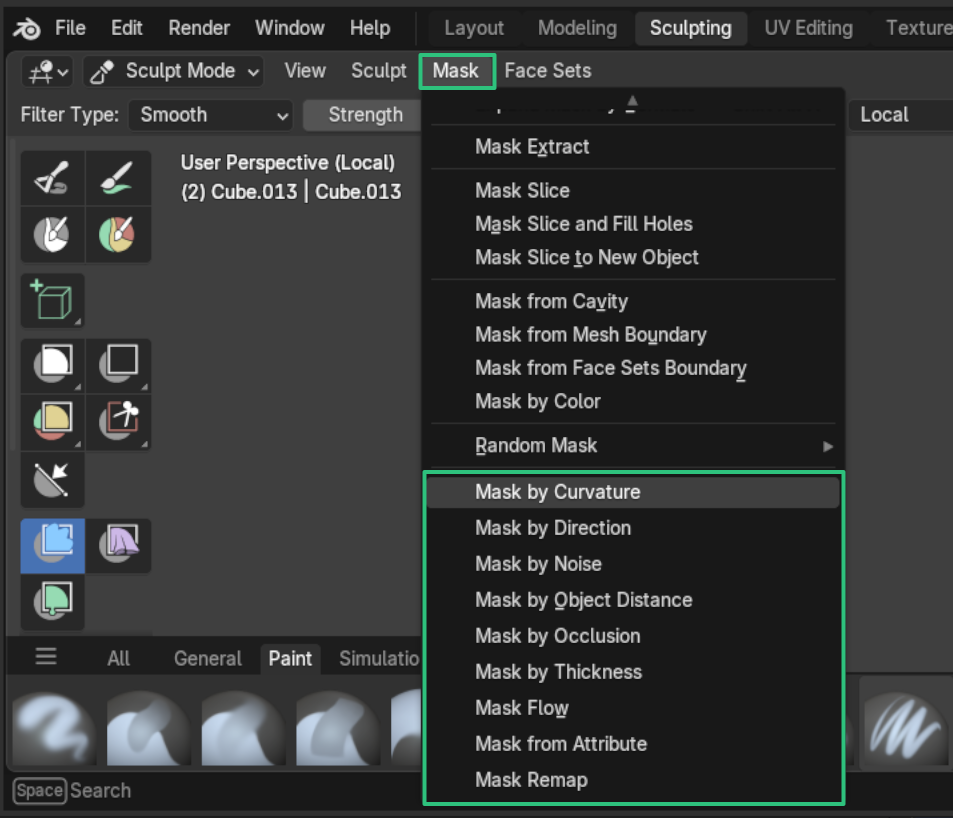

# Working with Sculpting Masks

Sculpting mask tools are available through the ***Mask*** menu in sculpt mode.

{width=512}

Each mask tool has similar settings to its modifier counterpart with extra options for how to blend with the current mask.

<iframe width="90" height="390" src="https://www.youtube.com/embed/146v89nkX_I?si=maBUzSN7hOg5292_&amp;start=169" title="YouTube video player" frameborder="0" allow="accelerometer; autoplay; clipboard-write; encrypted-media; gyroscope; picture-in-picture; web-share" referrerpolicy="strict-origin-when-cross-origin" allowfullscreen></iframe>