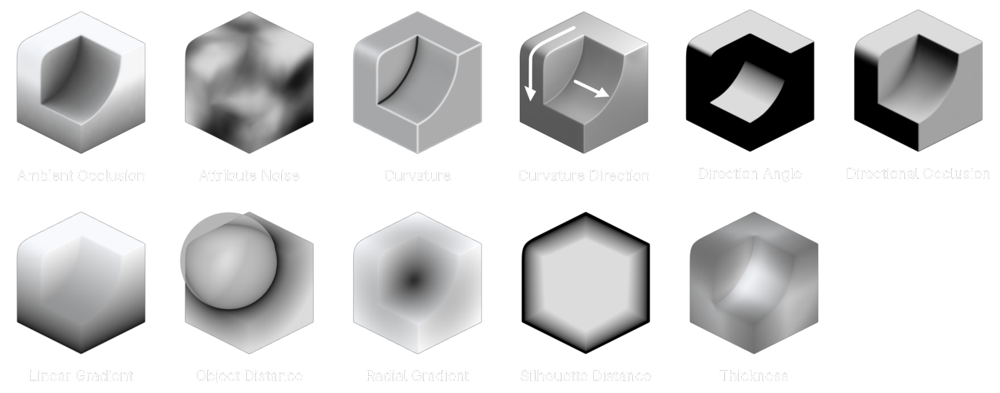
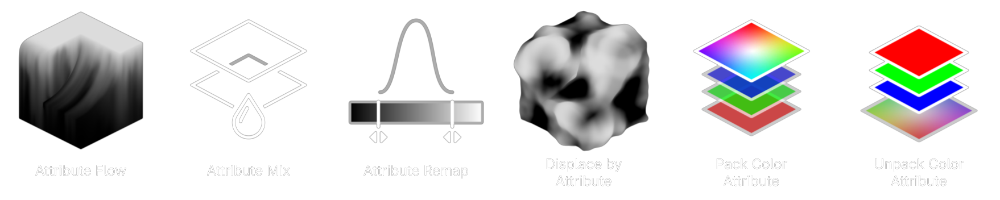
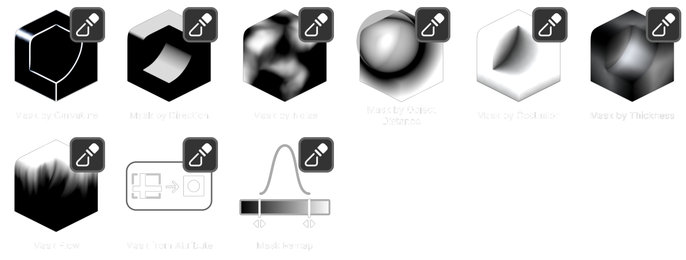

# vertLab for Blender

Welcome to the vertLab documentation. Here you'll find everything there is to know about the tools.

<iframe width="900" height="390" src="https://www.youtube.com/embed/3VxWpMOqhU4?si=Q2jnlvSUTBhWN2i3" title="YouTube video player" frameborder="0" allow="accelerometer; autoplay; clipboard-write; encrypted-media; gyroscope; picture-in-picture; web-share" referrerpolicy="strict-origin-when-cross-origin" allowfullscreen></iframe>

## What is vertLab?

VertLab is a collection of tools for controlling **vertex attributes** and **sculpting masks**.

Attributes are incredibly versatile. Example use-cases include:

- Use to drive shader effects e.g. texture blending.
- Use to displace geometry, or drive any procedural geometry effect.
- Bake to textures.
- Pack to vertex colors and export to a game engine.

!!! info "vertLab is Geometry Based"
    The resolution of vertLab is directly influenced by mesh density/topology.
    

### :material-plus-network: Create Attributes

Create attributes from advanced mesh analysis tools such as ray-traced occlusion and curvature. Other generators include noise, gradients and camera-based silhouette.

### :octicons-sliders-24: Modify Attributes

Modify attributes by remapping, mixing together or flowing them down a mesh. You can also pack up to four attributes to a vertex color for exporting to game engines.

### :material-brush: Sculpting Masks

Use vertLab's powerful attribute tools directly on sculpting masks. This includes mask creation, manipulation and blending.

