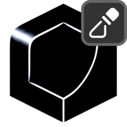

# Mask by Curvature

{ width=128 }

Creates a mask from mesh curvature. Internally uses the vertLab [Curvature](../create_attributes/curvature.md) modifier.

## Settings
#### Mix
Mix generated mask with existing one.

- **Blend Mode:** Blend mode with existing mask:
    - **Disable:** Disable blend.
    - **Replace:** Replace A with B.
    - **Multiply:** Muliply A by B.
    - **Add:** Add B to A.
    - **Min:** Minimum value of A and B.
    - **Max:** Maximum value of A and B.
    - **Screen:** Brighten A using the brightness of B.
    - **Overlay:** Brighten/darken A using values above/below 0.5 on B.
    - **Divide:** Divide A by B.
    - **Subtract:** Subract B from A.
- **Opacity:** Opacity of blend.

----
#### Curvature
Settings for curvature generation.

- **Curvature:** What areas of curvature to mask:
    - **Full Curvature:** Map full curvature to 0-1 range. 0.5 = No curvature, >0.5 = Convex, <0.5 = Concave.
    - **Convexity:** Map convexity to 0-1 range. 0 = Flat or concave, 1 = Maximum convexity.
    - **Concavity:** Map concavity to 0-1 range. 0 = Flat or convex, 1 = Maximum concavity.
    - **Absolute Curvature:** Ignore concavity/convexity. Map any curvature to 0-1 range.
- **Method:** Method for measuring mesh curvature:
    - **Edge Angle:** Average edge angle for each vertex. Cheap curvature with no scale.
    - **Mean Curvature:** Mean curvature of mesh. Values are relative to a specified distance.
    - **Gaussian Curvature:** Gaussian curvature of mesh. A measure of surface shape: domes/bowls are lighter, saddles are darker. Values are relative to a specified distance.
    - **Raycast Curvature:** Use raycast collisions in a sphere to approximate larger scale curvature. Higher ray lengths will darken concave areas.
    - **SDF Curvature:** Generate a SDF from the mesh to read curvature from.
- **Space:** Which space to calculate curvature in.
    - **Local:** Use object coordinates.
    - **Global:** Use world coordinates.
- **Scale:** Distance that curvature is measured against. Sets the black/white points of the output.
- **Max Angle:** Maximum edge angle. Sets the black/white points of the output.
- **Calculate on Boundaries:** Cast rays from mesh boundaries. When on boundaries will often show convex curvature.
- **Ray Count:** Number of rays cast from each point. More rays increases quality but is more expensive. You can use a blur to smooth noise instead of raising the number of rays too high.
- **Ray Length:** Maximum distance to check for ray collisions. This will likely increase collisions and therefore scew the curvature towards concave (darker).
- **Voxel Size:** Voxel size of the SDF, smaller values will create more detailed results but get exponentially more expensive. Hold [Shift] for more granular control.
- **Smooth SDF:** Number of iterations to smooth the SDF before reading curvature.

----
#### Blur
Blur curvature to smooth results, useful for reducing raycast noise.

- **Blur Iterations:** Blur iterations to apply to curvature.

----
#### Values
Further adjust mask values.

- **Contrast:** Add S-curve contrast to values.
- **Contrast Midtone:** Change the midpoint of the contrast S-curve.
- **Black Point:** Black point of mask, increase to spread black values.
- **White Point:** White point of mask, decrease to spread white values.

