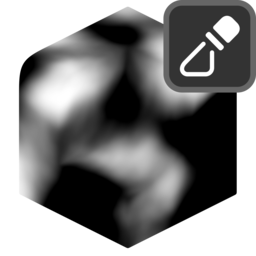

# Mask by Noise

{ width=128 }

Creates a mask from noise. Internally uses the vertLab [Attribute Noise](../create_attributes/attribute_noise.md) modifier.

## Settings

#### Mix
Mix generated mask with existing one.

- **Blend Mode:** Blend mode with existing mask:
    - **Disable:** Disable blend.
    - **Replace:** Replace A with B.
    - **Multiply:** Muliply A by B.
    - **Add:** Add B to A.
    - **Min:** Minimum value of A and B.
    - **Max:** Maximum value of A and B.
    - **Screen:** Brighten A using the brightness of B.
    - **Overlay:** Brighten/darken A using values above/below 0.5 on B.
    - **Divide:** Divide A by B.
    - **Subtract:** Subract B from A.
- **Opacity:** Opacity of blend.

----
#### Noise Settings
- **Noise Type:** Type of noise to generate:
    - **fBM.**
    - **Voronoi Distance.**
    - **Voronoi Cells.**
    - **Multifractal.**
    - **Hybrid Multifractal.**
    - **Ridged Multifractal.**
- **Voronoi Type:** Voronoi feature to compute:
    - **F1:** Distance to closest point.
    - **F2:** Distance to second closest point.
    - **Edge Distance:** Distance to edge of voronoi cell.
- **Distance:** Distance metric:
    - **Euclidian:** Euclidian distance (actual 3d distance).
    - **Manhattan:** Manhattan distance, separates distance components and adds them together.
    - **Chebychev:** Chebychev distance, separates distance components and chooses largest.
    - **Minkowski:** Minowski distance.
- **Feature Size:** Size of the largest features in the noise.
- **Offset:** Offset the noise W position. Effectively a smooth transition between seeds.
- **Detail:** The number of noise octaves. Higher values give more detailed noise but increase render time.
- **Roughness:** Blend factor between an octave and its previous one. A value of zero corresponds to zero detail.
- **Lacunarity:** The difference between the scale of each two consecutive octaves. Larger values corresponds to larger scale for higher octaves.
- **Octave Offset:** An added offset to each octave, determines the level where the highest octave will appear.
- **Gain:** An extra multiplier to tune the magnitude of octaves.
- **Exponent:** Exponent of the Minkowski distance.
- **Randomness:** Randomness of Voronoi points.

----
#### Distortion
- **Scale X:** X Scale applied to noise coordinates. Useful for directional noise such as wood grain or rock strata.
- **Y:** Y Scale applied to noise coordinates. Useful for directional noise such as wood grain or rock strata.
- **Z:** Z Scale applied to noise coordinates. Useful for directional noise such as wood grain or rock strata.

----
#### Normal Warp
- **Normal Warp:** Amount to use normals to warp the noise. Turning this to 1 will ignore position and use only normal.
- **Normal Blur:** Iterative blur for normals, use to smooth out the normal warping.

----
#### Noise Warp
- **Warp Amount:** Amount to warp the noise.
- **Feature Size:** Size of the largest features in the distortion noise.
- **Offset:** Offset the noise W position. Effectively a smooth transition between seeds.
- **Detail:** The number of noise octaves. Higher values give more detailed noise but increase render time.
- **Scale Effect:** How much non-uniform scale is applied to the warp noise.

----
#### Values

----
#### Histogram
- **Invert.**
- **Splits:** Create a saw-tooth banding effect. This value corresponds to the number of bands applied.
- **Fold:** Invert values above/below a threshold. Another method of creating a banding effect. Can be used to remove the abrupt changes in values caused by splits:
    - **None.**
    - **Peaks:** Invert values above a threshold.
    - **Valleys:** Invert values below a threshold.
- **Threshold.**

----
#### Contrast
- **Gamma:** Adjust gamma (power) of values.
- **S-Curve:** Intensity of S-curve applied to value. 0 = linear, 1 = maximum S-curve, -1 = maximum negative S-curve.
- **S-Curve Midpoint:** Shift the inflection point of the S-curve.
- **Interpolation:** Interpolation used for values:
    - **Linear:** Linear interpolation.
    - **Smooth Step:** Smooth Hermite edge interpolation (increases contrast).
    - **Smoother Step:** Smoother Hermite edge interpolation (further increases contrast).
